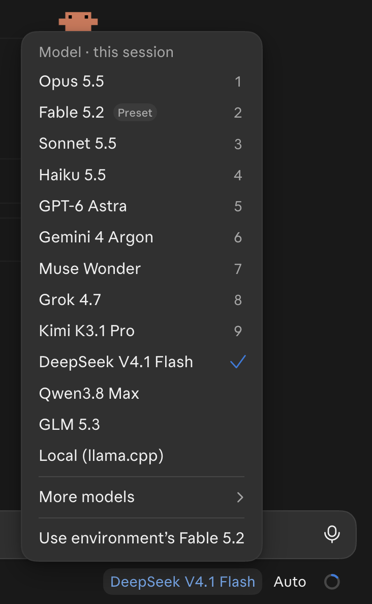
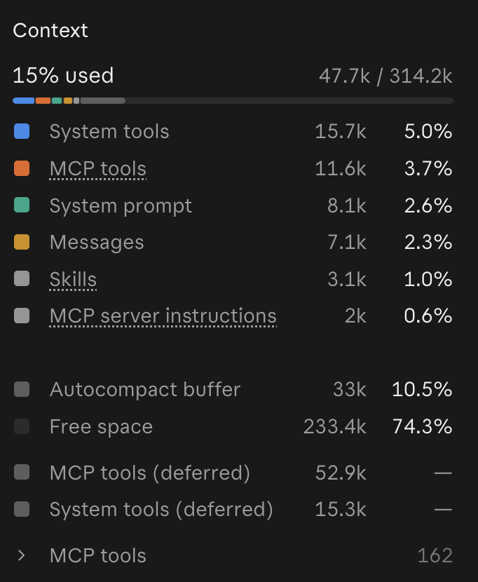

# AutoClaude

**Your own models in the official Claude Code and Claude Desktop: in the same
menu as Claude, next to your subscription.**

```
Claude Code ──► autoclaude ──┬─► api.anthropic.com   (any model not in the config)
                             ├─► DeepSeek
                             └─► vLLM, llama.cpp, OpenRouter, …
```

> [!WARNING]
> Anthropic does not support this, and using it with your subscription is at
> your own risk. Read [Anthropic's terms](#anthropics-terms) first.

## The problem

Most coding agents let you plug in any model. Claude Code does not.

- **Claude Desktop has no setting for another endpoint.** Its Code sessions
  always talk to `api.anthropic.com`, whatever your settings say. The only
  way out is third-party mode.
- **Third-party mode is a different app.** It replaces your claude.ai
  sign-in altogether and discovers "only models whose IDs are recognizably
  Claude"
  ([docs](https://claude.com/docs/third-party/claude-desktop/gateway)). It
  also drops voice mode, sharing, cloud sessions, chat-history search and
  access from the phone and the web
  ([docs](https://claude.com/docs/third-party/claude-desktop/feature-matrix)).
- **The menu is fixed.** Desktop gets it from `claude.ai`, and it lists
  Claude models only.
- **The CLI has one endpoint for everything.** `ANTHROPIC_BASE_URL` moves
  every request to it. There is no "Claude from my subscription, and DeepSeek
  for the rest", and Anthropic "doesn't support routing Claude Code to
  non-Claude models through any gateway"
  ([docs](https://code.claude.com/docs/en/llm-gateway)).

So you pick: Claude with everything around it, or your model somewhere else.

## What you get

With AutoClaude your models feel native, as if Claude Code had always had
them.

- **They are in the model menu.** In Desktop's menu and in `/model` in the
  CLI, under the names you give them.
- **You switch in the middle of a conversation.** To your model and back to
  Claude; the conversation goes on.
- **Everything around the model stays.** Tools, streaming, history, memory,
  projects: it is the same app, signed in to the same account.
- **The context meter is right.** It shows your model's own window, and the
  conversation is compacted in time.
- **Claude is untouched.** Requests for Claude models go to Anthropic as they
  are, on your subscription.
- **Nothing is patched.** No modified app, no system-wide certificate. One
  command sets it up, one removes it.

<table>
  <tr>
    <td valign="top"></td>
    <td valign="top"></td>
  </tr>
  <tr>
    <td>Other models in the menu of Claude Desktop</td>
    <td>A local model with the context window from the config</td>
  </tr>
</table>

## How it works

AutoClaude is a small gateway on your machine. Claude Code sends it every
request; the gateway looks at the `model` field and nothing else.

- A model that is not in your config goes to Anthropic, with the client's
  own credentials.
- A model that is goes to its provider, with your key for that provider. The
  provider never sees your subscription token or your account.
- A conversation that changes models in the middle is repaired on the way, so
  that the next model accepts it.

Your models have to be served over the **Anthropic Messages API**; that is
the only one Claude Code speaks. DeepSeek, OpenRouter, vLLM, llama.cpp and
Ollama offer it. For an endpoint that has only the OpenAI API, put a
translator such as [LiteLLM](https://github.com/BerriAI/litellm) in front
of it.

[How it works](docs/how-it-works.md) answers the questions this raises: what
exactly is changed in a request, what a model switch costs, what `install`
puts on your machine and why the gateway is safe to run.

## Set it up

You need:

- Claude Code or Claude Desktop, signed in to your subscription;
- a model to add, served over the Anthropic Messages API: a key from a
  provider, or a model running on your machine;
- [Go](https://go.dev/dl/) 1.26.4 or newer, to build the command.

### 1. Get the command

```bash
go install github.com/zemf4you/autoclaude/cmd/autoclaude@latest
```

If your shell does not find `autoclaude` afterwards, add Go's directory to
your `PATH`:

```bash
echo 'export PATH="$HOME/go/bin:$PATH"' >> ~/.zshrc && exec zsh
```

### 2. Install

```bash
autoclaude install
```

It asks one question: how your models should appear in Claude Desktop. The
CLI needs no choice; there they are in `/model` either way.

| | In place of Claude models | As entries of their own |
|---|---|---|
| What you see | The standard menu. You give your model the place of a Claude model you do not use: you pick *Opus 4.6*, and DeepSeek answers | Your models in the menu under their own names: you pick *DeepSeek V4 Pro* |
| How it feels | Like a workaround | Native |
| What install asks of you | Nothing more | Your password, once, and on macOS one click in System Settings |
| The risk | The lower one | The higher one: it changes what Anthropic's service sends to the app |

> [!WARNING]
> Either way Anthropic does not support this, and may suspend an account
> that breaks its terms. Entries of their own go further than the other way.
> Read [Anthropic's terms](#anthropics-terms) before you choose.

You can change your mind at any time: run `autoclaude install` again.

Then it lists what it is about to change on your machine and asks whether to
go ahead; nothing happens before your yes. Where your system wants your
password or a click, the command says so and waits for you. When it is done,
restart Claude Code and Claude Desktop.

Nothing behaves differently yet: with no models of yours, every request goes
to Anthropic as before.

### 3. Add your models

Install ends by offering to open `~/.autoclaude/config.toml`, where they go.
Later, the same file opens with:

```bash
autoclaude edit
```

Describe a provider and a model:

```toml
[providers.deepseek]
base_url = "https://api.deepseek.com/anthropic"
api_key = "sk-..."

[[model]]
id = "deepseek-v4-pro"   # what you pick in Claude Code
provider = "deepseek"
name = "DeepSeek V4 Pro" # what menus call it
context = 1000000        # its context window, in tokens
```

If your models take the place of Claude models, say which one:

```toml
slot = "claude-opus-4-6"
```

[Configuration](docs/configuration.md) lists every setting.

When you close a terminal editor, the config is applied by itself. If the
file opened in a window instead, apply it once you have saved it:

```bash
autoclaude reload
```

Either way you see the models the gateway now serves, and anything in the
config it could not use.

### 4. Use them

Restart Claude Desktop, or start a new session of the CLI, and pick your
model in the model menu; in the CLI that is `/model`. To go back, pick a
Claude model: the conversation goes on with it.

`autoclaude status` shows at any time what is set up, which models you have
and whether their providers answer.

## Commands

| Command | What it does |
|---|---|
| `autoclaude install` | Sets everything up. Run it again to change how your models appear in Claude Desktop |
| `autoclaude edit` | Opens the config in your editor and applies it when you are done |
| `autoclaude reload` | Applies a config you edited yourself. Nothing restarts; Desktop's menu shows the change the next time Desktop starts |
| `autoclaude status` | Shows what is set up, your models and whether their providers answer |
| `autoclaude uninstall` | Removes everything `install` added |
| `autoclaude run` | Runs the gateway in the foreground, to [try it without install](docs/how-it-works.md#trying-it-without-install) |
| `autoclaude desktop` | Starts Claude Desktop with your models in its menu, where the setting for that [cannot be installed](docs/desktop.md#if-the-setting-cannot-be-installed) |

Tab completes them, in a terminal opened after install.

## Troubleshooting

| What you see | What to do |
|---|---|
| `autoclaude: command not found` | Add Go's directory to your `PATH`; see step 1 |
| Your model is not in Desktop's menu | Restart Desktop. A model that takes the place of a Claude model is under that model's name; `autoclaude status` says where each model is |
| The menu has no entries of your models' own | Run `autoclaude install` again and finish what it asks for; `autoclaude status` says what is missing |
| Your model does not answer | `autoclaude status` says whether its provider is reachable. `~/.autoclaude/autoclaude.err.log` has a line for each request: the model, who served it, the result |
| A local model takes a minute or more over the first message | Claude Code opens every conversation with tens of thousands of tokens of instructions, and the model has to read them all. The messages after that are fast |
| A model you configured is missing | `autoclaude reload` prints what it left out of the config and why |
| Claude itself stopped answering | The gateway is not running: run `autoclaude install` |

If you ever need Claude Code back as it was, at once: `autoclaude uninstall`.
Should that fail too, remove `HTTPS_PROXY` and `NODE_EXTRA_CA_CERTS` from
the `env` block of `~/.claude/settings.json` and restart Claude Code.

## Removing it

```bash
autoclaude uninstall
```

It says what it will remove and asks first. Then it stops the service and
takes back everything `install` added: the settings of Claude Code, the
lines in your shell's startup file and, if you chose entries of their own,
the certificate and Desktop's proxy setting. Restart Claude Code and Claude
Desktop afterwards.

Your config stays in `~/.autoclaude`; delete that folder to remove it and
the keys in it.

## Limitations

- A provider has to implement what Claude Code uses of the Messages API:
  streaming, tool use and, for the context meter, `count_tokens`.
- `context` takes 100,000 to 10,000,000 tokens; Claude Code accepts nothing
  else. [Smaller windows](docs/how-it-works.md#context-windows) are handled
  differently.
- A model switch starts the prompt cache over, and the new model does not see
  the previous model's thinking.
- Desktop's menu and the list of models belong to Anthropic's servers. If
  their format changes, your models leave the menu until AutoClaude catches
  up; Claude keeps working.
- Tested on macOS. The Windows and Linux paths follow Anthropic's
  documentation and have not been run yet: feel free to test them and open
  a pull request.

## Anthropic's terms

AutoClaude is not affiliated with Anthropic. This is a summary, not legal
advice; read the documents yourself.

> [!WARNING]
> Anthropic may suspend or terminate access to its services, subscriptions
> included, "at any time without notice"
> ([Consumer Terms](https://www.anthropic.com/legal/consumer-terms), §12).
> Using AutoClaude can cost you your account.

What applies to everything AutoClaude does:

- Anthropic "doesn't support routing Claude Code to non-Claude models
  through any gateway"
  ([LLM gateways](https://code.claude.com/docs/en/llm-gateway)). The same
  page describes a gateway in front of a subscription as a working setup:
  "a saved claude.ai login remains the active credential."
- Your subscription credentials pass through the gateway on their way to
  Anthropic. It runs on your machine, does not store them and sends them
  nowhere else, but Anthropic's rules for developers say they may not
  "collect, store, or intermediate Claude.ai credentials or session tokens"
  ([Legal and compliance](https://code.claude.com/docs/en/legal-and-compliance)).
- To tell Claude Code a model's context window, the gateway adds to the list
  of models that Anthropic's API returns to the client.

What entries of their own in Desktop's menu add:

- The gateway also decrypts Desktop's connection to `claude.ai` and adds
  entries to a response of that service. The Consumer Terms (§3) forbid to
  "interfere with, or disrupt" the services and to bypass "any of our systems
  or protective measures"; whether adding menu entries on your own machine
  falls under that is for Anthropic to judge.
- The gateway does not disguise itself, patch the app or defeat any of its
  checks. The proxy it uses is Desktop's own documented setting.

If that is more than you want to risk, let your models take the place of
Claude models instead: the connection to `claude.ai` is then left alone.

## Development

```bash
make test   # go vet and the race-enabled test suite; providers are faked
make build
```

| Package | What it holds |
|---|---|
| `cmd/autoclaude` | The command: its subcommands, questions and output |
| `internal/gateway` | Routing and request repair, an `http.RoundTripper` |
| `internal/proxy` | One listener for direct and proxied traffic |
| `internal/menu` | The model lists of Claude Desktop and of Claude Code sessions |
| `internal/claudecode`, `internal/desktop` | What `install` sets up in each |
| `internal/config` | The configuration file |

## License

[MIT](LICENSE)
